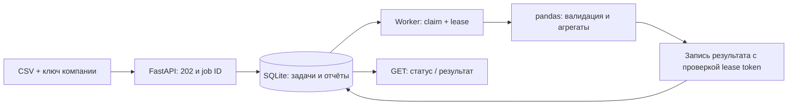

# Sales Analytics Pipeline

[](https://github.com/Sultanbro/sales-analytics-pipeline/actions/workflows/checks.yml)

**Python · pandas · FastAPI · SQLite · Background worker · pytest · Docker**

Фоновая обработка выгрузок продаж: HTTP API принимает CSV и сразу возвращает задачу, worker строит сводки по датам, категориям и валютам, а отчёт показывает дубли, некорректные строки и статистические выбросы.

Проект демонстрирует применение Python для обработки табличных данных вместе с backend-задачами: очередью, повторной обработкой, отменой, идемпотентностью и изоляцией компаний. Все примеры синтетические.

## Запуск и демонстрация

Нужны Docker Compose и Python 3 для настройки/демо.

```sh
git clone https://github.com/Sultanbro/sales-analytics-pipeline.git
cd sales-analytics-pipeline
python3 scripts/setup.py
docker compose up --build -d --wait
python3 scripts/demo.py
```

Документация API: **http://localhost:8010/docs**. Ключи двух демонстрационных компаний находятся в локальном `.env`; для Authorize используйте значение нужной компании из `TENANT_KEYS_JSON`.

Демо отправляет [`examples/sales.csv`](examples/sales.csv), получает ID задачи, проверяет повтор загрузки и запрет доступа другой компании, затем ждёт результат отдельного worker. Ожидаемый результат: **15 строк → 11 приняты, 4 отклонены**; оборот отдельно **108700 центов USD** и **1500 центов EUR**. Один крупный платёж помечен статистическим правилом для просмотра.

Два worker на одной базе:

```sh
docker compose up -d --scale worker=2
python3 scripts/demo.py
```

`docker compose down` останавливает сервисы, сохраняя базу. `docker compose down -v` удаляет локальные задачи и отчёты.

## API

`X-API-Key` определяет компанию. ID компании не принимается из тела или заголовка `X-Tenant-ID`. Две компании не могут читать, перечислять или отменять задачи друг друга.

| Метод | Путь | Назначение |
| --- | --- | --- |
| POST | `/v1/jobs` | Принять CSV, вернуть `202` и `Location` |
| GET | `/v1/jobs` | Метаданные задач компании; `limit` до 50, `offset` |
| GET | `/v1/jobs/{id}` | Состояние и готовый JSON-отчёт |
| POST | `/v1/jobs/{id}/cancel` | Отменить задачу в очереди/обработке |
| GET | `/health` | Проверить API и базу; не проверяет worker |

Создание требует `Idempotency-Key`:

```json
{"csv_data":"sale_id,date,category,amount,currency\nSALE-1,2026-01-01,books,10.50,USD\n"}
```

Одинаковый ключ и CSV внутри компании возвращают исходную задачу (`200`); другой CSV с тем же ключом — `409`. Другой компании разрешено использовать такой же ключ. Пробелы и переводы строк учитываются при сравнении исходных данных.

Ошибки: `401` — ключ; `404` — отсутствующая или чужая задача; `409` — конфликт идемпотентности/состояния; `413` — тело более 1.1 MB; `422` — неверная структура запроса. Ошибки содержимого CSV отражаются в состоянии фоновой задачи или отчёте качества.

## Аналитика и качество данных

Формат CSV: `sale_id,date,category,amount,currency`, UTF-8; допускается BOM. Максимум 10000 строк и 1000000 символов CSV.

- `sale_id`: латинские буквы, цифры, `_`, `-`, до 80 символов.
- `date`: календарная дата строго `YYYY-MM-DD`.
- `category`: непустая строка до 80 символов.
- `amount`: максимум 9 цифр до точки и 2 после; отрицательные суммы обозначают возврат. `NaN`, экспоненты и лишняя точность отклоняются.
- `currency`: три заглавные латинские буквы. Валюты не конвертируются; справочник ISO не проверяется.

Некорректная строка исключается и получает код причины с номером строки. Среди строк, прошедших проверку полей, **все вхождения повторяющегося ID исключаются**. Произвольный выбор одного дубля не производится. Если все строки отклонены, задача завершается с пустыми агрегатами и полным отчётом ошибок.

`Decimal` переводит суммы в целые сотые единицы до обработки pandas. Поэтому финансовые итоги не используют `float`. Агрегации выполняются отдельно по валюте, дню и категории.

Статистическое правило: для валюты с минимум 8 принятыми строками используются границы `Q1 − 1.5 × IQR` и `Q3 + 1.5 × IQR`. Такие строки отмечаются в `outliers`, **но остаются в итогах**. Это объяснимый сигнал для просмотра; он не является ML-моделью, доказательством ошибки или оценкой мошенничества. Квантили вычисляются в float, денежные суммы — в целых единицах.

## Очередь и обработка сбоев



Состояния: `queued → running → succeeded / failed`; `queued` и `running` можно перевести в `cancelled`.

- Worker забирает задачу транзакционно и получает уникальный lease token на 120 секунд. Два worker не получают одну действующую аренду.
- После истечения аренды другой worker может повторить задачу. При записи результата проверяется ID задачи, статус, токен и срок аренды: старый worker не перезапишет новый результат.
- Неожиданные ошибки дают повтор с задержками 2 и 4 секунды; всего максимум 3 попытки. Ошибки формата CSV не повторяются. Три аварийно истёкшие аренды также завершают задачу ошибкой.
- Отмена блокирует запись результата уже работающего worker. Она не прерывает выполняющееся вычисление внутри pandas.
- Исходный CSV очищается из активной строки базы после завершения или отмены. Это логическое удаление поля, не гарантированное стирание байтов SQLite/WAL/резервных копий. Отчёты сохраняются.
- Идемпотентность обеспечивается уникальным ключом `(tenant, request_key)`. Выполнение имеет семантику **at least once**, а запись результата защищена fencing-токеном; обещания «ровно один запуск» нет.

SQLite позволяет запустить весь пример без брокера. Это очередь для одного хоста с общей локальной базой, а не замена распределённой системе задач. При масштабировании на несколько узлов разумно вынести очередь в брокер или PostgreSQL, добавить heartbeat аренды, квоты, хранение файлов отдельно и политику удаления отчётов.

## Структура и проверка

- [`pipeline/analysis.py`](pipeline/analysis.py) — проверка данных, группировки и IQR.
- [`pipeline/store.py`](pipeline/store.py) — идемпотентность, очередь, транзакции и lease fencing.
- [`pipeline/worker.py`](pipeline/worker.py) — отдельный процесс, повтор и завершение.
- [`pipeline/api.py`](pipeline/api.py) — HTTP, ключи компаний, лимиты и документация.

Python 3.12+:

```sh
python3 -m venv .venv
. .venv/bin/activate
pip install -r requirements-dev.txt
pytest -q
ruff check .
ruff format --check .
```

Без Docker экспортируйте настройки из `.env`, запустите `uvicorn pipeline.api:create_app --factory --port 8010`, а в другом терминале с той же `DATABASE_PATH` — `python -m pipeline.worker`.

Тесты проверяют точность итогов, валюты, дубли, валидацию, идемпотентность, 40 конкурентных запросов worker к 25 задачам, восстановление после истечения аренды, отклонение устаревшего результата, отмену, повтор и изоляцию компаний. В тестах времени часы управляемые — не нужно ждать аренду две минуты. CI отдельно запускает HTTP API и один/два worker в Docker.

Доступ по API-ключу рассчитан на внутренний API; для общего внешнего сервиса потребуются пользовательская авторизация, TLS, квоты и мониторинг очереди. Ограничения размера входят в текущую реализацию; горизонтальное масштабирование и SLA не заявляются.

## Почему Python

Обработка CSV, проверка качества и группировки — подходящая задача для экосистемы pandas. Здесь она соединена с HTTP API и устойчивым жизненным циклом задачи, чтобы показать и обработку данных, и backend-подход.

Источники: [pandas groupby](https://pandas.pydata.org/docs/user_guide/groupby.html), [Decimal](https://docs.python.org/3/library/decimal.html), [FastAPI testing](https://fastapi.tiangolo.com/tutorial/testing/). Раздел о повторах учитывает общий принцип [идемпотентности фоновых задач](https://docs.celeryq.dev/en/v5.6.1/userguide/tasks.html); Celery в этом проекте не используется.

MIT License.
